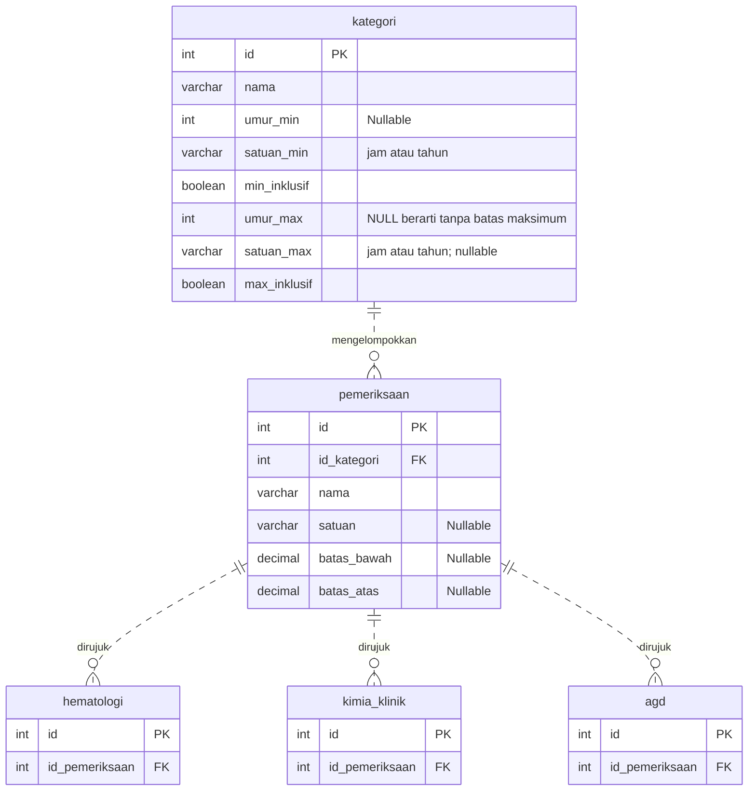
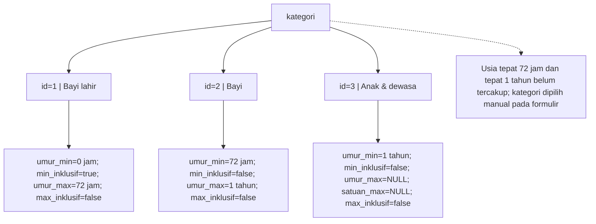
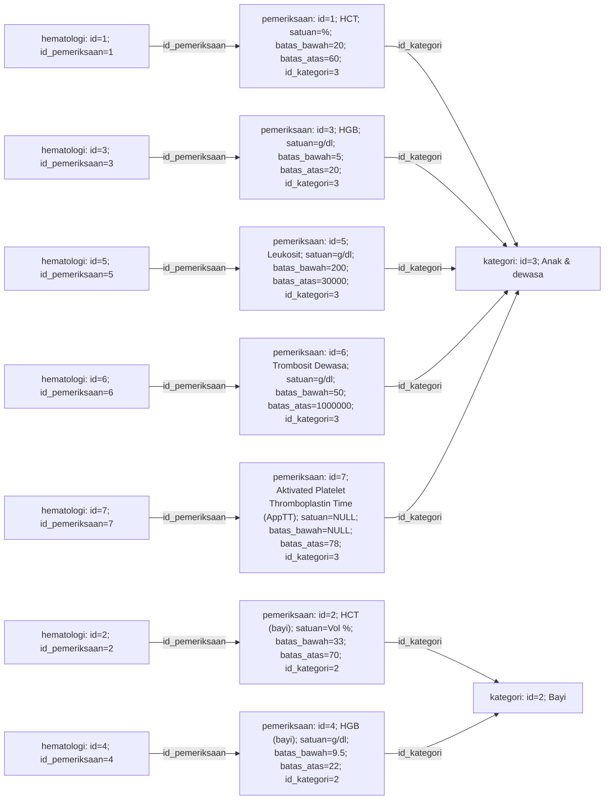
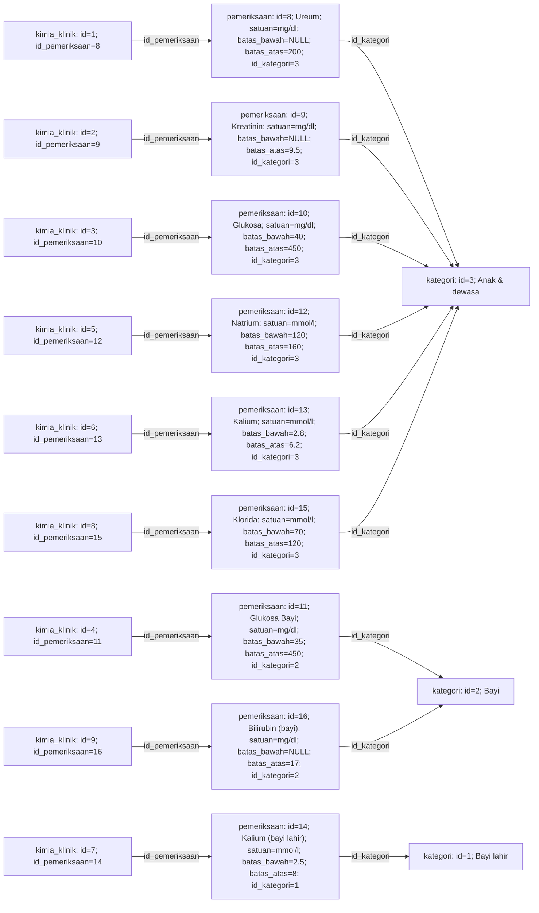
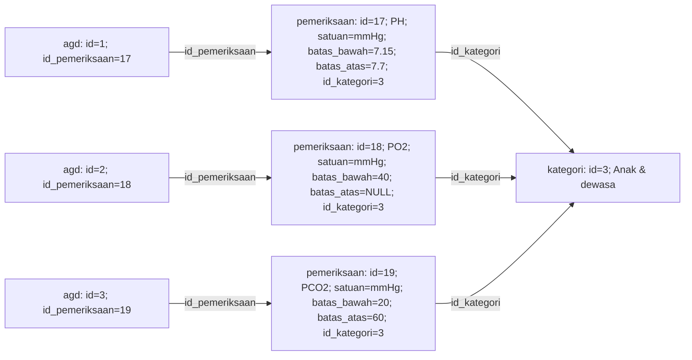
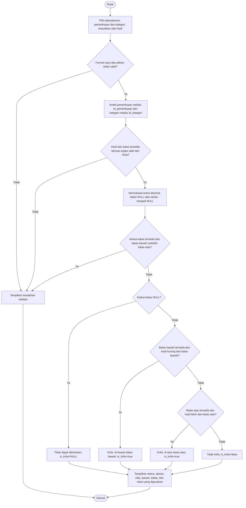

# Diagram laboratorium dan penentuan nilai kritis

Dokumentasi struktur dan data yang digunakan di `index.php`: 7 pemeriksaan hematologi, 9 kimia klinik, dan 3 AGD. Data aplikasi masih berupa array PHP, belum tabel database fisik. Nama, satuan, dan ambang mengikuti daftar pengguna.

## 1. Relasi seluruh tabel

Setiap baris pemeriksaan memiliki satu kategori. Tabel laboratorium merujuk pemeriksaan melalui `id_pemeriksaan`; kategori tidak diduplikasi di tabel laboratorium. Garis putus-putus menunjukkan relasi non-identifying: foreign key bukan bagian primary key.

## 2. Kategori dan batas umur

`rentang` pada array PHP adalah teks tampilan yang menjelaskan kolom batas umur. Inklusif berarti usia tepat pada batas ikut termasuk. Satu tahun mengacu pada ulang tahun pertama.

Pemeriksaan tanpa label usia dipetakan ke kategori 3 sesuai keputusan implementasi sebelumnya. Pemeriksaan berlabel bayi menggunakan kategori 2; bayi lahir menggunakan kategori 1. Tidak ada penggantian otomatis dengan ambang kategori lain.

## 3. Seluruh data dan relasi per laboratorium

Setiap diagram berikut menunjukkan baris tabel laboratorium, baris pemeriksaan yang dirujuk, satuan, batas bawah/atas, dan kategori. ID pada tabel laboratorium adalah nomor lokal; ID pemeriksaan unik untuk seluruh data. Angka menggunakan titik desimal tanpa pemisah ribuan: `30000` dan `1000000`. Batas `NULL` ditampilkan sebagai `-` dalam aplikasi. Kondisi kritis menggunakan operator `<` untuk batas bawah dan `>` untuk batas atas.

### Hematologi

### Kimia Klinik

### Analisa Gas Darah (AGD)

## 4. Alur input dan penentuan kritis

Diagram mengikuti validasi formulir dan fungsi `tentukanKritis()` di `index.php`. Batas dibaca dari data pemeriksaan, bukan dari input pengguna. Tanda `-` atau `NULL` hanya diterima sebagai batas yang tidak tersedia; hasil pemeriksaan harus berupa angka.

Nilai tepat pada batas tidak dianggap kritis. Status tidak kritis bukan penetapan bahwa hasil normal. Input desimal menerima titik atau koma, tanpa pemisah ribuan. Hasil formulir tidak disimpan ke database.